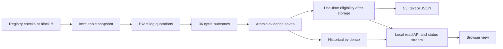

# Read-only analysis guide

Pooltrace compares exact USDC → WETH → USDC quotations at one Ethereum block. The working slice
can report a qualified grid, its best tested gross result, and separate save status. Transaction costs
and estimated net profit remain unavailable because no full-transaction cost producer exists.

Start with the [setup](../README.md#development-setup) and
[CLI instructions](../README.md#diagnostic-cli). This guide explains calculations, examples, and
result interpretation for the calculation implementation at `99fe048`, documented on 2026-11-18.
M1-10 adds persistence and cli-v2 without changing those calculations.
M1-11/M1-12 expose the same backend calculations through the local read API/browser and application
startup workflow; their task records own implementation and validation evidence.
[CORRECTNESS](CORRECTNESS.md) owns requirements; [ADR-0005](adr/0005-registry-verification-and-consistent-snapshots.md)
and [ADR-0006](adr/0006-quotation-cycles-and-profitability.md) own the accepted policies and rationale.
[M1-08](tasks/M1-08-mathematics-and-evidence-documentation.md#evidence-and-handoff) records this
guide's verification. Documentation does not make the rest of M1 complete.

## Workload and shared authority

The selected workload uses chain ID 1, verified USDC/WETH deployments, and three factory-discovered
pools. Symbols are labels; addresses and observed metadata establish token direction and units.

| Ordinal | Venue | Fee parameter, in millionths | Nominal fee |
| --- | --- | --- | --- |
| 0 | Uniswap V2 | 3000 | 0.3% |
| 1 | Uniswap V3 | 500 | 0.05% |
| 2 | Uniswap V3 | 3000 | 0.3% |

Each of the six configured USDC sizes is tested through every ordered pair of distinct venues:
`(0,1)`, `(0,2)`, `(1,0)`, `(1,2)`, `(2,0)`, `(2,1)`. This gives 36 route/size outcomes.
The default sizes are 10, 50, 100, 500, 1000, and 5000 USDC; the README owns override syntax.
A changed input grid requires qualification at those actual amounts.



The CLI calls shared backend modules directly in one Node process.
[Domain functions](../packages/domain/src/index.ts) own pure exact arithmetic and ranking;
[protocol adapters](../packages/protocols/src/quotes.ts) own Router02/QuoterV2 calls;
[snapshots](../apps/backend/src/snapshot.ts) and [analysis](../apps/backend/src/analysis.ts) own
attempts, clocks, validation, and sealed evidence. The backend's
[store](../apps/backend/src/storage/store.ts) preserves collection, analysis, and renewal versions
in SQLite. The service schedules serial attempts independently of browsers. Its producer guard is
shared with the one-shot CLI, so two producers cannot collect into one evidence file at once.
Browser requests consume backend evidence and create no execution transaction or collection job.

Save status is independent of calculation quality. A confirmed save does not extend freshness;
eligibility is checked after storage and can already be stale. Unknown commits are never labeled
saved. Original evidence and quote amounts remain immutable; later invalidation is a retained
witness that also applies to older branches. Loaded history preserves original origin/as-of state
but never restores current live admission or a current best. The [README](../README.md#diagnostic-cli)
owns paths, cli-v2 fields, exits, and operational limits.

Registry checks cover code presence, factory discovery, distinct pools, decimals, token ordering,
factory/fee/spacing identities, positive reserves/liquidity, and initialized/unlocked V3 state.
These structural checks precede finite-size qualification. The original snapshot keeps
`finiteSizeSuitability: unavailable`; linked analysis records add size-specific evidence without
rewriting the source. [Registry implementation](../packages/protocols/src/registry.ts).

## Units and exact representation

| Quantity | Representation |
| --- | --- |
| USDC amount | Bigint in 10^-6 USDC; `1` is 0.000001 USDC, `10000000` is 10 USDC |
| WETH amount | Bigint in 10^-18 WETH; `1000000000000000` is 0.001 WETH |
| V2 reserves | Raw base units of the verified token0/token1 |
| V3 sqrt price | Q64.96 square-root ratio; square/invert it to obtain a raw-unit price ratio |
| Gas allowance/diagnostic estimate | Gas units, not wei or USDC |
| Gas price/transaction charge | Wei per gas / wei; requires separate complete cost evidence |
| Block timestamp | Seconds since Unix epoch; wall-clock `asOf`/observation times use milliseconds |
| Monotonic time | Process-local milliseconds used for elapsed/deadline checks |

Financial arithmetic uses bigint and integer ratios. JSON serializes bigint as exact decimal
strings. For a leg quote, `input` uses `tokenIn` units and `output` uses `tokenOut` units. Cycle-row
input, final output, and gross are all USDC base units; the intermediate leg-one output is WETH.
Do not parse amounts through Number before formatting them.

The six-size parser accepts positive increasing distinct decimal strings with at most six decimal
places, normalizes them exactly, and rejects values above `2^255 - 1`. Signs, exponents, excess
precision, and normalized duplicates fail before RPC. WETH leg-two inputs come from actual
leg-one output, not another independently configured size. [Parser and checks](../packages/domain/test/validation.test.ts).

A raw ratio `n/d` means output base units per input base unit. To express it in whole output
tokens per whole input token, multiply by `10^inputDecimals / 10^outputDecimals`. Decimal conversion
does not change the authoritative raw quote. A USDC token amount is not an assertion of USD value.

## V2 quotation and rounding

For positive input `A`, select `Rin` and `Rout` by the verified input/output addresses, then compute:

```text
Af = A × 997
N = Af × Rout
D = Rin × 1000 + Af
q = floor(N / D)
```

There is one final division. The nominal 0.3% fee is already included. Pooltrace checks positive
uint112 reserves, uint256 arithmetic, output below `Rout`, and its additional supported-model
restriction `Rin + A <= 2^112 - 1`. A numeric zero output rejects the leg; a failed read is unavailable.
The token mapping and expression follow the
[pinned V2 library](https://raw.githubusercontent.com/Uniswap/v2-periphery/ed24991304291297c3b4a52818d02f46a17aa9a2/contracts/libraries/UniswapV2Library.sol).

Each distinct V2 leg input is compared with deployed Router02 `getAmountsOut` for the same
two-token path and block. The echoed input and output must match exactly. A mismatch is rejected;
a failed comparison is unavailable. The local computed amount may remain as a diagnostic, but
its dependent cycle cannot become an eligible result. This is quotation evidence, not proof of
approvals, balances, supported transfer behavior, or execution success.

## V3 quotation and full-input evidence

Pooltrace calls the official QuoterV2 `quoteExactInputSingle` with exact token addresses, input,
fee, and an explicit sqrt-price limit. It records output, post-quote sqrt price, initialized ticks
crossed, and diagnostic gas. It does not implement V3's swap engine.
[Pinned QuoterV2](https://raw.githubusercontent.com/Uniswap/v3-periphery/24ccf014fe7f81d74a14c1689d6fdf123f280e45/contracts/lens/QuoterV2.sol).

For starting sqrt price `s`, the raw marginal price is:

| Direction | Output base units per input base unit | Requested limit |
| --- | --- | --- |
| token0 → token1 | `s² / 2^192` | `MIN_SQRT_RATIO + 1` |
| token1 → token0 | `2^192 / s²` | `MAX_SQRT_RATIO - 1` |

The starting limit must lie strictly beyond `s` in the requested direction. The constants and
Q64.96 representation are pinned in
[TickMath](https://raw.githubusercontent.com/Uniswap/v3-core/5ea68a77cb541c6b3812df783be71ba8c081e25f/contracts/libraries/TickMath.sol)
and retained in the [domain implementation](../packages/domain/src/index.ts).

For the supported source-backed contracts, Pooltrace infers full input consumption from a
consistent returned price strictly inside the requested limit. Leg qualification also requires
positive output:

```text
token0 → token1: limit < sqrtAfter <= sqrtBefore
token1 → token0: sqrtBefore <= sqrtAfter < limit
```

This inference uses the pool loop's input-exhaustion/price-limit stopping conditions. It is an
inference under those contract assumptions, not a returned consumed-input field.
[Pinned pool implementation](https://raw.githubusercontent.com/Uniswap/v3-core/5ea68a77cb541c6b3812df783be71ba8c081e25f/contracts/UniswapV3Pool.sol).
A return exactly at the limit is `full_input_not_proven`, even if consumption might have been
complete there. Opposite movement or an out-of-range return is inconsistent/unavailable evidence.
A partial output must not be composed as if the whole input were spent.

## Impact policy, composition, and ranking

The per-leg admission threshold is 100 bps inclusive, relative to that pool's fee-adjusted
pre-trade marginal output. This is Pooltrace's research policy, not slippage tolerance or an
execution guarantee. For raw reference `n/d`, input `A`, fee `f` in millionths, and output `q`:

```text
F = 1000000
X = A × n × (F - f)
D = d × F
shortfall = max(0, X - q × D)
displayedImpactBps = ceil(10000 × shortfall / X)
pass iff q > 0 and 10000 × shortfall <= 100 × X
```

For V2, the reference is `Rout/Rin`; V3 uses the direction-specific ratio above. Input/reference
values must be positive and the fee verified. Compare exact cross-products rather than rounding
the ideal `X/D` first. The metric removes the nominal fee from the marginal reference; actual fee
rounding remains in the quoted output. [Policy decision](adr/0006-quotation-cycles-and-profitability.md#5-finite-size-admission-and-price-impact-metric).

Every route uses its first leg's exact WETH output as second-leg input. Different pools are used,
so the first swap does not require changing the second pool's quoted state. Each tested route is
an independent hypothetical transaction; routes do not consume one another's liquidity.
Both legs of every configured route/size must pass. Keep all 36 outcomes if one fails; do not
drop sizes, substitute a tier, or rank an unapproved smaller grid.

For final USDC output `Z`, signed gross is `G = Z - A`. Fees and price impact are already in `Z`.
Do not subtract them again or deduct slippage tolerance. Rank the largest signed USDC gross,
then smaller initial input, then route ordinals. The metric string `absolute_usdc_gross_surplus`
means an amount denominated in USDC; it does not select the largest absolute loss or rank ROI.
[Ranking implementation](../packages/domain/src/index.ts), [ordering regressions](../packages/domain/test/validation.test.ts).

The best tested result may be negative or zero; it is not a global optimum or net-profit result.
A usable nonpositive grid is a normal CLI outcome. A rejected/incomplete/stale/invalidated grid
has diagnostics but no authoritative best result.

## Constructed worked examples

These examples come from [independent domain vectors](../packages/domain/test/validation.test.ts),
[wire checks](../packages/protocols/test/quotes.test.ts), and
[composition checks](../apps/backend/test/validation.test.ts). They are constructed inputs,
not market observations. They use a different test profile from the CLI's default fixture data.
The existing root verification command includes these tests; the formulas also permit independent
integer/rational recalculation.

### Direction and one final floor

Suppose V2 holds `2000000000000` USDC base units (2,000,000 USDC) and `1000000000000000000000`
WETH base units (1,000 WETH). Reversing direction reverses which reserve is input/output:

| Direction | Input base units | Output base units | Output in whole tokens |
| --- | --- | --- | --- |
| USDC → WETH | `10000000` (10 USDC) | `4984975149898877` | 0.004984975149898877 WETH |
| WETH → USDC | `1000000000000000000` (1 WETH) | `1992013962` | 1992.013962 USDC |

The first output satisfies `q × D <= N < (q + 1) × D`; rounding it upward would overstate the
result. The reverse row illustrates direction, not an independently sized second leg of a cycle.

### Two exact composed paths

For this constructed profile only, let the V3 starting price be `25000 × 2^96`. Its forward raw
ratio is `625000000`; whole-token conversion gives `1/1600` WETH per USDC. The V3 responses are
deliberately fee-adjusted marginal constructions, not a full swap model. Combined with the V2
reserves above, the independently specified 10 USDC paths are:

| Route | Exact leg-one WETH base units | Final USDC base units | Signed gross USDC |
| --- | --- | --- | --- |
| V2 → V3-500 | `4984975149898877` | `7971972` | -2.028028 |
| V3-500 → V2 | `6246875000000000` | `12456191` | 2.456191 |

The constructed prices deliberately differ. The positive row checks composition and gross
labeling; it is not an actual opportunity or evidence of available estimated net profit.
Do not reproduce these values by adding a new CLI mode or treating the marginal response as a
real V3 quote. [Constructed response helper](../packages/protocols/test/validation-fixture.ts).

### Exact and fractional impact boundaries

With `A = 1000000` and raw ratio `1/1`, output `987030` at fee 3000 is exactly 100 bps below
the fee-adjusted ideal `997000`, so it passes. Output `987029` fails. At fee 500, output `989505`
is the corresponding inclusive endpoint below ideal `999500`; one less fails.

For a fractional reference, take input `1000`, ratio `10/3`, and fee 3000. The exact ideal is
`9970/3` output base units. Output `3290` fails and displays 101 bps; `3291` passes and displays
98 bps. Prematurely flooring the ideal would wrongly accept the lower output. These are raw-unit
predicate examples, not a market price or a new configured trade-size grid.

## Qualification and current eligibility

The result keeps facts separate rather than collapsing them into a single success flag:

| Fact/field | Interpretation |
| --- | --- |
| Source `observation.complete` | Required snapshot payload reads completed; identity/structural checks and later qualification are separate |
| `coverageComplete` | All 36 terminal cycle rows are accounted for, including failed/blocked rows |
| `quotesComplete` | Every row has numeric final output/gross; numeric zero or a retained diagnostic still does not establish qualification |
| `qualified` | Quotation contract identity and all configured row qualifications passed at the recorded state |
| `canonical` | Latest supported validation is valid/unavailable, or an invalidation event has made the record terminal |
| `freshness` / `validationExpired` | Age/lag/clock/origin interpretation and whether control validation must be renewed |
| `workloadAdmitted` | The qualified live-origin result is usable under its current temporal/canonical gates |
| `best` | Best tested gross only when the comparison is usable; fixture/historical inspection can have a best result without live admission |
| `transactionCost` / `netProfit` | Explicitly unavailable in the current analysis pipeline |

For example, all quotes can qualify while final validation is unavailable. The amounts remain
inspectable, but live admission is false and `best` is null. Already qualified row statuses describe
the recorded block; they are not continuously rewritten to claim current freshness.
[Eligibility implementation](../apps/backend/src/analysis.ts), [failure/lifecycle checks](../apps/backend/test/validation.test.ts).

CLI `status` summarizes usable, rejected, incomplete, stale, invalidated, unavailable, cancelled,
or configuration-error outcomes. Inspect the eligibility fields and row/quote reasons for the
detail; the envelope's single reason is not a substitute for them. A missing output is not zero.
Local V2 calculations can remain diagnostic after comparison failure/cancellation, and a received
zero can remain numeric on a rejected quote. Neither becomes a usable cycle or a best result.

## One block, bounded work, and time

Collection selects concrete block B and discovers/verifies the pools there. Every state call,
including retries, uses B's hash and `requireCanonical: true`; code reads use the same selector.
Fresh chain/B-number-to-hash/head checks validate canonicality and lag. Unknown-hash capability
probes detect some unsupported behavior, but do not prove that a provider is always honest.
[Snapshot decision](adr/0005-registry-verification-and-consistent-snapshots.md#3-one-selected-block-hash-per-collection-attempt).

| Existing policy | Bound |
| --- | --- |
| Live block age | At most 30,000 ms |
| Live head lag | At most two blocks |
| Validation age | At most 5,000 ms, measured monotonically |
| Future block-clock tolerance | At most 2,000 ms; excessive skew/clock rollback makes freshness unavailable |
| Request timeout | 5,000 ms |
| Collection / quote phase | Each has its own 20,000 ms attempt deadline; quoting does not reset B's age |
| Shared in-flight requests | At most four; three quote workers leave capacity for control validation |
| Transient retry | At most one retry at the same hash; minimum 250 ms wait, honoring a longer valid Retry-After if it fits |
| Quote-phase budget | 100 logical reads / at most 200 sends, including control work; three final control reads reserved |
| Quote call gas allowance | 5,000,000 gas per call; not a cost estimate |

These are recorded policy bounds, not throughput or latency guarantees.
[Runtime policy](../packages/protocols/src/types.ts), [quote policy](../packages/domain/src/index.ts).
Renew expired validation before new quote dispatch/use; share the same reader/budget with quotes.
Within an analysis, identical-context leg reads may be reused by reference. Validation is never
cached, and another attempt/block/size cannot be substituted.

Confirmed hash replacement or an unambiguous noncanonical response invalidates the observation
and dependent results permanently. A later good response cannot resurrect that record. Ambiguous
validation failure is unavailable, not proof of reorganization; explicit renewal may recover it
if the other gates still pass. Late responses cannot modify sealed outcomes or another attempt.

Origin remains explicit. Fixture data is constructed; historical replay quotes a selected past
block and still enforces canonical/hash and operational rules without the live recency requirement.
Both can be inspected but never gain live admission. The public CLI offers live/fixture modes;
historical replay is an integration-harness behavior. Test injection can exercise live-mode logic
with constructed responses, so an origin label alone is not independent market evidence.

The CLI recomputes eligibility immediately before output and exits. Wall-clock/as-of and validation
events describe that moment. Monotonic timestamps belong to the collecting process; reading a
saved JSON file cannot restore live eligibility. There is no archive-loading or watch command.

## Reading browser and service evidence

Application readiness and market-data eligibility answer different questions. A ready backend has
validated configuration, exclusive producer ownership, an initialized evidence store, and a bound
server. It can still report no analysis, failed RPC, rejected quotes, negative gross, unavailable
costs, or expired validation. Browser connection state and persistence acknowledgement are separate
facts again. Read them alongside the observation's origin, block/hash, and as-of time.

The service runs one collection/analysis attempt at a time and waits after completion before the
next. Its status stream does not produce quotes or renew old validation. After a confirmed save,
the current view checks the existing age/canonicality gates; expired evidence loses current best
and admission until a newly qualified attempt is available. Gaps are honest evidence of those
limits, not a reason to widen the policy or treat the last positive result as current.

SSE status events identify the backend instance and view sequence. They ask the browser to refresh
or withdraw a view; only a current-view response confirms its as-of eligibility. The browser counts
the entire request duration against the server's remaining validity, so delayed delivery never
starts a fresh five-second interval. Stream loss, silence, or page suspension removes current
presentation until a fresh response confirms it. Reconnecting resynchronizes state, not a durable
stream history, and never starts another collector.

Historical API records keep exact amounts, source references, original origin/as-of information,
and known invalidation. Their retrieval context is historical even if the original observation was
live. A stored as-of ranking can be inspected but cannot become a current live best. Restart begins
without restored admission. See the [application commands](../README.md#local-application),
[ADR-0008](adr/0008-local-api-sse-and-process-interface.md), and the M1-11/M1-12 evidence records.

## Costs and conditional accounting

Current analysis always returns `full_transaction_evidence_missing` for costs/net profit, even
when gross is positive. Quoter gas estimates, sums of leg gas, the call allowance, or a supplied
number do not establish complete executor cost.

The domain's conditional accounting function can check an explicit matching model/evidence bundle:

```text
Cwei = gasUnits × effectiveWeiPerGas + otherChargesWei
costUsdcBase = ceil(Cwei × n / d)
netUsdcBase = finalUsdcBase - inputUsdcBase - costUsdcBase
```

The selected valuation is the exact maximum of the three verified marginal ratios at B, expressed
in USDC base units per WETH wei. Cost conversion rounds upward once. This model assumes WETH/native
ETH unit correspondence; the maximum is conservative among those venues, not an independent
oracle, liquidation quote, or protection against manipulation/depegging. Do not add base fee again
to an already effective gas price.

Required context includes origin, chain/block, route/input, configuration, producer/executor/calldata
revisions, complete charges, fee/cost observation times, model validity, and matching valuation
state. Missing/incompatible/stale evidence leaves cost/net unavailable. Existing fixture/model unit
checks do not create a producer or expose a live-cost override in the CLI. M2 owns the separately
reviewed executor/cost evidence and execution validation.
The helper does not collect or independently verify valuation snapshots; the reviewed producer
must establish that provenance.
[Conditional implementation](../packages/domain/src/index.ts),
[accounting decision](adr/0006-quotation-cycles-and-profitability.md#7-transaction-cost-and-net-profit-semantics).

## Reading an actual archived CLI result

This walkthrough uses [M1-06's JSON stdout archive](evidence/M1-06-cli-live-2026-11-18.json),
an actual read-only observation that is now historical evidence. The archive retains the original
`origin: live` and as-of eligibility; those values do not claim it is live now. The
[M1-06 task](tasks/M1-06-cli-and-configuration.md#actual-read-only-live-cli) owns the actual command,
exit result, sandbox/network distinction, and archive formatting notes.

| Locate | Recorded value / meaning |
| --- | --- |
| Envelope | `formatVersion: cli-v1`, `status: usable`, `constructed: false` |
| `asOf` | `1795008147790` = 2026-11-18T13:22:27.790Z |
| `analysis.observation.chainId` | `1` |
| `analysis.observation.block` | Block `26442213`, timestamp `1795008131` seconds |
| Selected hash | `0x870eb62544c3caff40148b1fa2f5f62d7a530ed6d2eed111af22f3e542468c5a` |
| `analysis.observation.validations` | Original and appended validation events; final head `26442214` and validation time `1795008147788` |
| `eligibility` | Coverage/numeric completeness/qualification true; canonical valid, fresh, age 16790 ms, head lag 1, validation unexpired, admitted at that event |
| `eligibility.best` | Route `[2,1]` (V3-3000 → V3-500), input `10000000`, gross `-24121` |
| Costs/net | Unavailable, `full_transaction_evidence_missing` |

The source observation ID is `684b4041-adbf-4c99-ac51-87cdc062d7fc`. The analysis ID is
`97744c0d-9b8c-4240-87c8-d13206989c26`. Follow the best route/input to its row in `analysis.rows`:

1. `leg1` points to quote ID ending `:36` under that analysis prefix. Its input is `10000000`
   USDC base units; its output is `5559215312564322` WETH base units, or 0.005559215312564322 WETH.
2. `leg2` points to quote ID ending `:48`. Its input is exactly that WETH output; its output is
   `9975879` USDC base units, or 9.975879 USDC.
3. The row's gross is `9975879 - 10000000 = -24121`, or -0.024121 USDC. Both quote records link to
   the same observation/analysis IDs and B hash. Their full-input, impact, target/method, limit,
   and diagnostic gas fields permit inspection of the dependencies.

This was the best tested gross at the recorded event, despite being negative. It was neither
an execution nor net-profit result. The separate [text archive](evidence/M1-06-cli-live-2026-11-18.txt)
was collected at block 26442216; it is not a same-state formatting comparison with this JSON run.

## Evidence map and remaining limits

| Evidence | What actually ran / where to inspect |
| --- | --- |
| [M1-03 task](tasks/M1-03-registry-and-consistent-snapshots.md#evidence-and-handoff), [2026-11-17 report](evidence/M1-03-live-2026-11-17.json) | Registry/structural snapshot, deterministic historical comparison, and expiry/revalidation at block 26436521; finite-size suitability was unavailable |
| [M1-05 task](tasks/M1-05-quotation-and-cycle-analysis.md#evidence-and-handoff), [2026-11-18 report](evidence/M1-05-live-2026-11-18.json) | Qualified 36-entry grid at block 26441925, deployed V2 comparison/V3 evidence, same-block replay, and actual elapsed expiry/renewal |
| [M1-06 task](tasks/M1-06-cli-and-configuration.md#evidence-and-handoff), [JSON](evidence/M1-06-cli-live-2026-11-18.json), [text](evidence/M1-06-cli-live-2026-11-18.txt) | Actual CLI live runs on 2026-11-18 and separate offline/process/configuration/interrupt checks; live results were gross-negative with costs unavailable |
| [M1-07 task](tasks/M1-07-validation-and-regression-coverage.md#evidence-and-handoff) | 158 offline tests, including 42 added cases and a 205-tuple V2 corpus, plus clean frozen-lockfile verification; no new live run or production correction |
| [M1-08 task](tasks/M1-08-mathematics-and-evidence-documentation.md#evidence-and-handoff) | Documentation/example checks and new offline help/fixture command verification, distinguished from the earlier suite/integration results |
| [M1-10 task](tasks/M1-10-minimal-evidence-store.md#implementation-evidence), [JSON](evidence/M1-10-cli-live-2026-11-18.json), [text](evidence/M1-10-cli-live-2026-11-18.txt) | SQLite/cli-v2, exact immutable history, native/controlled-fault/process checks, clean install, and actual live saved reports; loaded records are historical |
| [M1-11 task](tasks/M1-11-local-api-sse-and-browser.md#implementation-evidence), [fixture API](evidence/M1-11-local-fixture-2026-11-18.json), [live API](evidence/M1-11-local-live-2026-11-18.json), [browser capture](evidence/M1-11-browser-live-2026-11-18.jpg) | Actual local API/SSE/browser/history, 36 qualified saved live outcomes at block 26444090, separate UI as-of capture, conservative expiry and producer exclusion; 262 offline tests and clean install/build |
| [M1-12 task](tasks/M1-12-local-startup-readiness-and-shutdown.md#implementation-evidence), [native process report](evidence/M1-12-local-process-2026-11-18.json) | Controlled launcher faults plus actual Bun/Node application startup, signals, CLI refusal, owned cleanup, closed listeners and historical reopen; macOS host only |

Reports describe past events. Re-running an integration harness selects new state and need not
produce the same amounts or admission. Local helper replies and CLI fixtures are constructed;
they are not independent deployed-protocol verification. Finite tests are not formal proofs.
Pinned reviewed source and runtime-code hashes identify provenance, not an independently reproduced
deployed binary or a security audit. The single configured provider and supported token/deployment
behavior remain external trust assumptions, including possible token upgrades.

There is no wallet, executor, transaction submission, fork simulation, or full-transaction cost
producer in this slice. M1-10 supplies local SQLite history; M1-11/M1-12 add the read-only local
application workflow with their own validation records. JSON redirection and checked-in reports
are separate report artifacts. M2 covers reviewed execution/cost/fork capabilities.
Provider fallback/gateway and additional chains remain separately scoped future work in the
[backlog](BACKLOG.md). These boundaries describe this increment, not the lifetime of Pooltrace.
