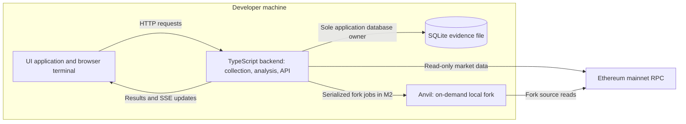
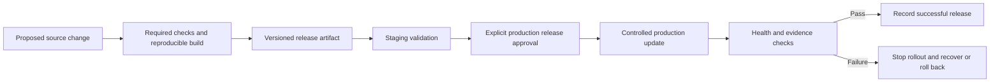

# Local runtime and future deployment plan

Status: Local architecture accepted in
[ADR-0004](adr/0004-local-processes-and-gated-deployment.md). Hosted deployment and the detailed
CI/CD pipeline below are future plans. M1-11/M1-12 implement the local workflow under
[ADR-0008](adr/0008-local-api-sse-and-process-interface.md); no hosted infrastructure or production
environment exists.

The next requested priority is PR verification before M2. [Accepted ADR-0009](adr/0009-pr-verification-and-repository-trust.md)
and approved [DEP-02](tasks/DEP-02-pr-verification-and-cloud-compatibility.md) define that setup.
The candidate passes local macOS/Ubuntu validation and its initial hosted baseline on PR #1.
Publication and hosted-check fixes are approved. The user enabled the main-branch ruleset;
agent administration and merging remain unapproved.
The shared contribution/authorization policy belongs in
[WORKFLOW.md](WORKFLOW.md#proposed-shared-pr-contributions).

## Local development architecture

Everything owned by Pooltrace initially runs on the developer's machine. Ethereum mainnet RPC is
an external, read-only data source. Localhost does not mean browser-only computation.

| Component | Lifecycle and ownership |
| --- | --- |
| UI application | One application process serves the UI; the browser renders and interacts. It requests analysis/history from the backend and does not access SQLite directly. |
| Backend | One application process owns RPC adapters, collection, domain analysis, persistence, HTTP API, and SSE. Module boundaries do not require more services. |
| SQLite | Embedded local file introduced with the first working backend in M1; no separate database-server process. The backend owns reads/writes and migrations. |
| Anvil | Separate loopback process introduced in M2, started for fork validation. Quoting and viewing data do not depend on it. Initially only one simulation job runs at a time. |
| CLI | One-shot diagnostic access to shared backend modules in explicit live/fixture modes. CLI and service share exclusive per-database producer ownership; use an isolated file or stop the service before CLI access to its file. |

The [README local application section](../README.md#local-application) owns the combined/individual
commands, ports and configuration. `bun run dev --mode live|fixture` starts the fixed Node entrypoints
with a fresh invocation ID and checks owned application readiness before reporting success. Failures
and signals stop only owned process groups. There is no automatic restart, port adoption or
port-owner termination. Native Bun-to-Node signals and actual Next descendants were verified on
macOS arm64 and Ubuntu 24.04 arm64; Windows remains unsupported. ADR-0001 selects Node.js for runtime and
Bun for tooling.

Collection must remain independent of browser refresh/navigation. Keep RPC credentials and database
access in the backend. Persist a complete observation/result record before notifying the UI that it
is stored; report persistence failures explicitly. Retain the distinction between unavailable,
stale, calculated, quoted, and simulated results from [CORRECTNESS.md](CORRECTNESS.md).

## Persistence and fork lifecycle

Keep the SQLite file on local durable storage outside build/release output. A process restart or UI
rebuild must not replace the evidence file. M1-10 implements the reviewed schema, exact encoding,
version-1 initialization and explicit persistence failures under [ADR-0007](adr/0007-minimal-sqlite-evidence-store.md).
The CLI owns one connection per invocation; the service retains its connection across serial
attempts and closes it before releasing producer ownership. Restarted history is never current
admission. A crash-left owner marker fails closed; the README documents manual verification before
removing one. M3 extends this with richer
history/replay and recovery; its scope no longer introduces the first database.

Anvil is controlled by the backend's simulation module once M2 is approved. Verify the selected
fork state and local execution endpoint, record setup and results, and isolate/reset state between
serialized jobs. Do not reset a shared fork during another job. Define timeouts, failed startup,
cancellation, shutdown, and whether an existing user-managed node can be used in the M2 design.
Never send execution transactions to the mainnet data-source endpoint.

Anvil supports local nodes and forks at chosen blocks.
[Foundry Anvil documentation](https://www.getfoundry.sh/anvil).
SQLite is application-local storage; consistent live backups need a supported procedure and a
verified restore, not an assumed copy of a changing file.
[SQLite backup guidance](https://www.sqlite.org/backup.html).

## Environment progression

| Environment | Purpose | State |
| --- | --- | --- |
| Local development | Run the two applications, early SQLite, and later optional Anvil on localhost | Implemented through M1-12; application, browser, clean build and native shutdown verified on macOS arm64; Anvil remains M2 |
| Automated verification | Reproducible builds and appropriate offline/integration/fork checks | DEP-02 initial hosted baseline passed; main ruleset active; stale-base integration pending; fork checks remain future M2 |
| Preview/staging | Validate a specific release candidate with isolated configuration and data | Future hosting design; not provisioned |
| Production | Host a reviewed research application and preserve evidence across updates | Future design; no server or deployment exists |

Hosting, containers and production process supervision remain open. ADR-0009 selects GitHub Actions
for PR verification independently of those choices. A future
host must support the chosen frontend features, a persistent collector/API process, durable data,
and any authorized native fork workload. Consider those requirements before selecting packaging
or a platform. Next.js offers server and static deployment options with different feature support.
[Next.js deployment documentation](https://nextjs.org/docs/app/getting-started/deploying).

Under the currently defined milestones, an eventual hosted production environment observes mainnet
read-only and executes transactions only on local forks. Hosting does not authorize live trading or
mainnet contract deployment; any such capability needs a separately reviewed milestone and design.

## PR verification implementation

[DEP-02](tasks/DEP-02-pr-verification-and-cloud-compatibility.md#implementation-evidence) is approved
and implemented before M2:
credential-free checks/build, Linux/macOS compatibility, automated fixture browser/API smoke,
candidate metadata and a fail-closed aggregate gate. The user enabled main-branch protection;
strict settings and a failing PR's blocked state are read back in the task.
ADR-0009 owns the accepted check contract and trust boundaries. Local macOS/Ubuntu validation and
the initial six-job hosted baseline passed with the same source digest. Hosted runners were Ubuntu
24.04 x64 and macOS 15 arm64; the task retains exact images, runtime/native versions and candidates.

[CONTRIB-01](tasks/CONTRIB-01-shared-pr-contributor-setup.md) then connects actual selected contributor
tools/identities to that same CI. Verify real PR creation/update events, approval identity and
revocation before enabling routine delivery. No provider integration or bot identity was configured
by this work; existing account connections remain unverified. Current human commit/push restrictions remain until the proposed
delivery policy is explicitly accepted/enabled.

Read-only GitHub inspection confirmed a public, personally owned repository. The user created
`Protect main` on 2026-11-19; ruleset readback confirms active default-branch targeting, required
PRs, resolved conversations, strict `pr-gate` bound to GitHub Actions app `15368`, deletion/force
push restrictions and no bypass actors. Required approvals remain zero until a distinct bot author
is verified. The connector can read this public ruleset but lacks protection administration.
Remaining stale-base and contributor-integration proof belongs in DEP-02/CONTRIB-01. Protection
settings, provider accounts and secrets are external changes requiring the task's explicit scope.
Workflow files alone do not establish enforcement. Missing permissions or unavailable plan features
must remain explicit setup gaps. Hosted staging and release promotion retain the separate gates below.

## Future release gates

This is a draft pipeline to implement only in a separately approved task. Local documented checks
come first. Passing checks never authorizes an agent to deploy or bypass the user's approval rule.

1. **Validate source changes.** Run formatting/lint/type checks, meaningful TypeScript tests,
   SQLite/schema/migration tests, application builds, and appropriate contract checks as they exist.
   Executor/protocol changes need relevant unit/fuzz/invariant and pinned fork evidence. Define
   which checks are required by change type before enabling the gate. Documentation-only changes
   should not need an unrelated fork run.
2. **Separate required external checks.** Live RPC and fork jobs need an authorized environment and
   recorded state. A required check that cannot run is unavailable/blocked, not passed. Keep
   untrusted source validation apart from release credentials and privileged jobs.
3. **Identify the candidate.** Record source revision, lockfiles/toolchain, configuration version,
   schema compatibility, artifact digest, and check evidence. Build once and promote the same tested
   artifact; choose environment configuration handling accordingly. A later source change must not
   inherit approval of an earlier candidate.
4. **Validate in staging.** Use isolated data/configuration. Exercise the UI/API, collection, stored
   provenance/history, SSE/reconnect, errors/stale/empty states, and applicable fork operations.
   Test schema upgrade from a representative previous version and confirm recovery readiness.
5. **Authorize production.** Review that exact candidate, required results, migration plan, known
   limitations, and recovery procedure before changing the production environment. Require explicit
   release authorization and serialize production deployments.
6. **Apply a controlled update.** Check compatibility and backup/restore readiness before migration.
   Preserve data independently of release artifacts, avoid overlapping collectors/migrations, and
   use the rollout/process-management method selected in the later hosting ADR.
7. **Verify and record.** Check application readiness and actual behavior, observation freshness,
   database access, API/UI operation, and relevant simulation availability. Record artifact/config/
   schema identity, checks, approver, rollout outcome, and any recovery action.
8. **Recover on failure.** Stop promotion and follow the reviewed rollback/recovery procedure.
   Application rollback does not automatically reverse schema changes. Plan compatibility, possible
   restore/replay, acceptable data loss, and recovery verification before deployment; do not assume
   restoring an older backup preserves writes made after that backup.

Define measurable regression budgets before using [benchmarks](BENCHMARKING.md) as release gates.
Do not turn noisy remote RPC timing into an unexplained automatic rejection or claim that passing
CI alone establishes financial correctness or production readiness.

GitHub Actions environments are one possible mechanism for protected deployments; their available
approval/protection features depend on repository visibility and plan. Verify the actual account
capabilities when selecting the CI platform; no such protection is configured here.
[GitHub deployment environments](https://docs.github.com/en/actions/how-tos/deploy/configure-and-manage-deployments/manage-environments).

## Decisions still open

[Accepted ADR-0008](adr/0008-local-api-sse-and-process-interface.md) specifies the implemented local
API/SSE/browser interface and foreground launcher. Completed
[M1-11](tasks/M1-11-local-api-sse-and-browser.md#implementation-evidence) and
[M1-12](tasks/M1-12-local-startup-readiness-and-shutdown.md#implementation-evidence) record actual
readiness, ownership, shutdown, browser/live and clean-build evidence. Hosted release gates remain separate.

Runtime pins and the minimal SQLite driver/schema/journal settings are selected and validated in
their task records. ADR-0009 is accepted. DEP-02 records selected action/browser pins and local
Linux/macOS results, hosted baselines and actual protection readback. Stale-base integration and
contributor identities still require verification in DEP-02/CONTRIB-01.
Fork lifecycle details still require M2 scope/design. Hosting,
release artifact packaging, staging layout, release checks/budgets, migrations/cutover, and rollback
procedures require a future deployment ADR. CI workflow YAML is prepared; no Dockerfile or hosted
provisioning script has been added. Official references for future deployment were checked on 2026-11-17; local runtime
research and actual results are in ADR-0008 and the completed task records.
