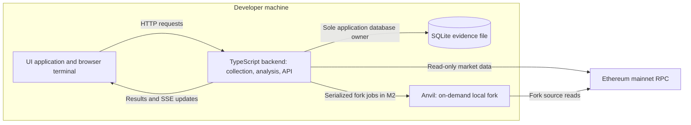
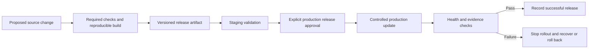

# Local runtime and future deployment plan

Status: Local architecture accepted in
[ADR-0004](adr/0004-local-processes-and-gated-deployment.md). Hosted deployment and the detailed
CI/CD pipeline below are future plans. No workflow, infrastructure, or production environment exists.

## Local development architecture

Everything owned by Pooltrace initially runs on the developer's machine. Ethereum mainnet RPC is
an external, read-only data source. Localhost does not mean browser-only computation.

| Component | Lifecycle and ownership |
| --- | --- |
| UI application | One application process serves the UI; the browser renders and interacts. It requests analysis/history from the backend and does not access SQLite directly. |
| Backend | One application process owns RPC adapters, collection, domain analysis, persistence, HTTP API, and SSE. Module boundaries do not require more services. |
| SQLite | Embedded local file introduced with the first working backend in M1; no separate database-server process. The backend owns reads/writes and migrations. |
| Anvil | Separate loopback process introduced in M2, started for fork validation. Quoting and viewing data do not depend on it. Initially only one simulation job runs at a time. |
| CLI | Diagnostic access to shared backend behavior, not another always-running collector. Its exact API/standalone mode must preserve one collection/write owner. |

Keep a simple development command that starts both application processes when implemented, with
individual commands available for debugging. Show readiness and startup failures clearly. Stop only
processes owned by the launcher; do not terminate unrelated user processes. Ports/configuration and
the exact Node/Bun runtime are decided in the approved foundation task.

Collection must remain independent of browser refresh/navigation. Keep RPC credentials and database
access in the backend. Persist a complete observation/result record before notifying the UI that it
is stored; report persistence failures explicitly. Retain the distinction between unavailable,
stale, calculated, quoted, and simulated results from [CORRECTNESS.md](CORRECTNESS.md).

## Persistence and fork lifecycle

Keep the SQLite file on local durable storage outside build/release output. A process restart or UI
rebuild must not replace the evidence file. Review a minimal schema, exact amount encoding,
migrations, and persistence failure behavior before M1 storage code. M3 extends this with richer
history/replay and recovery; its scope no longer introduces the first database.

Anvil is controlled by the backend's simulation module once M2 is approved. Verify the selected
fork state and local execution endpoint, record setup and results, and isolate/reset state between
serialized jobs. Do not reset a shared fork during another job. Define timeouts, failed startup,
cancellation, shutdown, and whether an existing user-managed node can be used in the M2 design.
Never send execution transactions to the mainnet data-source endpoint.

Anvil supports local nodes and forks at chosen blocks.
[Foundry Anvil documentation](https://www.getfoundry.sh/anvil).
SQLite is application-local storage; consistent live backups need a supported procedure and a
verified restore, not an assumed copy of a changing file.
[SQLite backup guidance](https://www.sqlite.org/backup.html).

## Environment progression

| Environment | Purpose | State |
| --- | --- | --- |
| Local development | Run the two applications, early SQLite, and later optional Anvil on localhost | Design agreed; implementation unapproved |
| Automated verification | Reproducible builds and appropriate offline/integration/fork checks | Future CI design; not configured |
| Preview/staging | Validate a specific release candidate with isolated configuration and data | Future hosting design; not provisioned |
| Production | Host a reviewed research application and preserve evidence across updates | Future design; no server or deployment exists |

Do not select a host, container platform, process supervisor, or CI provider in this setup. A future
host must support the chosen frontend features, a persistent collector/API process, durable data,
and any authorized native fork workload. Consider those requirements before selecting packaging
or a platform. Next.js offers server and static deployment options with different feature support.
[Next.js deployment documentation](https://nextjs.org/docs/app/getting-started/deploying).

Under the currently defined milestones, an eventual hosted production environment observes mainnet
read-only and executes transactions only on local forks. Hosting does not authorize live trading or
mainnet contract deployment; any such capability needs a separately reviewed milestone and design.

## Future CI/CD gates

This is a draft pipeline to implement only in a separately approved task. Local documented checks
come first. Passing checks never authorizes an agent to deploy or bypass the user's approval rule.

1. **Validate source changes.** Run formatting/lint/type checks, meaningful TypeScript tests,
   SQLite/schema/migration tests, application builds, and appropriate contract checks as they exist.
   Executor/protocol changes need relevant unit/fuzz/invariant and pinned fork evidence. Define
   which checks are required by change type before enabling the gate. Documentation-only changes
   should not need an unrelated fork run.
2. **Separate required external checks.** Live RPC and fork jobs need an authorized environment and
   recorded state. A required check that cannot run is unavailable/blocked, not passed. Keep
   untrusted source validation apart from release credentials and privileged jobs.
3. **Identify the candidate.** Record source revision, lockfiles/toolchain, configuration version,
   schema compatibility, artifact digest, and check evidence. Build once and promote the same tested
   artifact; choose environment configuration handling accordingly. A later source change must not
   inherit approval of an earlier candidate.
4. **Validate in staging.** Use isolated data/configuration. Exercise the UI/API, collection, stored
   provenance/history, SSE/reconnect, errors/stale/empty states, and applicable fork operations.
   Test schema upgrade from a representative previous version and confirm recovery readiness.
5. **Authorize production.** Review that exact candidate, required results, migration plan, known
   limitations, and recovery procedure before changing the production environment. Require explicit
   release authorization and serialize production deployments.
6. **Apply a controlled update.** Check compatibility and backup/restore readiness before migration.
   Preserve data independently of release artifacts, avoid overlapping collectors/migrations, and
   use the rollout/process-management method selected in the later hosting ADR.
7. **Verify and record.** Check application readiness and actual behavior, observation freshness,
   database access, API/UI operation, and relevant simulation availability. Record artifact/config/
   schema identity, checks, approver, rollout outcome, and any recovery action.
8. **Recover on failure.** Stop promotion and follow the reviewed rollback/recovery procedure.
   Application rollback does not automatically reverse schema changes. Plan compatibility, possible
   restore/replay, acceptable data loss, and recovery verification before deployment; do not assume
   restoring an older backup preserves writes made after that backup.

Define measurable regression budgets before using [benchmarks](BENCHMARKING.md) as release gates.
Do not turn noisy remote RPC timing into an unexplained automatic rejection or claim that passing
CI alone establishes financial correctness or production readiness.

GitHub Actions environments are one possible mechanism for protected deployments; their available
approval/protection features depend on repository visibility and plan. Verify the actual account
capabilities when selecting the CI platform; no such protection is configured here.
[GitHub deployment environments](https://docs.github.com/en/actions/how-tos/deploy/configure-and-manage-deployments/manage-environments).

## Decisions still open

Exact runtime, SQLite driver/schema/journal settings, endpoint/process supervision, API contracts,
and fork lifecycle details require their relevant implementation ADRs. Hosting, artifact packaging,
CI provider, staging layout, checks/budgets, migrations/cutover, and rollback procedures require a
future deployment ADR. No workflow YAML, Dockerfile, provisioning script, server, or application
process is created by this document. Official references were checked on 2026-11-17.
