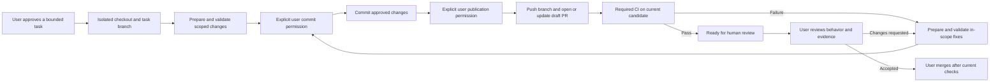

# Development workflow

## Authorization

Implementation requires explicit user approval for a named task, milestone, or otherwise clearly
bounded change. Record authorization and evidence in the relevant task record, or use the
[lightweight documentation path](#work-lifecycle) for small corrections. [STATUS.md](STATUS.md)
summarizes the active phase.

The product brief is future scope. Backlog entries, roadmap dates, proposed or accepted ADRs, and
an agent's plan do not authorize implementation. Silence is not approval. Do not create application
code, implementation scaffolding, tests, contracts, UI, package manifests, or install dependencies
during setup.

Design acceptance and implementation approval are separate. The user may approve both in one
message; record that without asking again. Within an approved scope, make routine implementation
choices independently. Return to the user only when a material design or scope change needs a
decision. Completing a task does not authorize starting the next one.

Requested documentation changes and read-only inspection can proceed within their stated scope.
Create a dedicated task branch before editing, including documentation-only work. Keep each branch
and PR scoped to one approved change; put unrelated work on a separate branch. Deliver changes
through a PR to `main`; the user reviews and merges. Do not edit on or deliver directly to `main`.

Before editing, inspect the current branch, working tree, staged changes, and existing worktrees.
For a new task, fetch `origin` and create the branch from current `origin/main` unless another base
is explicitly selected. If fetching is unavailable, report that the base could not be refreshed.
Continue an existing task on its own branch; use a separate checkout/worktree when the current one
contains unrelated work. Preserve that work rather than carrying it into the new task or discarding it.

Agents must not commit unless the user explicitly instructs them to commit. Implementation
approval, a requirement to use PRs, and general PR-delivery approval do not imply commit permission.
Until that instruction arrives, prepare and validate the changes on the task branch and leave them
uncommitted. Push and PR publication also require the user's authorization. Permission for one
action or task does not authorize another task, agent approval/merge, auto-merge, repository
administration, or deployment. Never label agent-written decisions as user approvals.

Unless the user explicitly authorizes a series of commits for a bounded scope, a commit instruction
covers the currently prepared change only. Later CI or review fixes may be prepared within the
approved scope, but require another explicit commit instruction before committing. An instruction
such as "commit and create a PR" authorizes that commit, the necessary task-branch push, and PR
creation together; "commit" alone does not authorize publication. Do not request permission again
for an action already covered by the user's instruction.

Future production changes follow the draft gates in [DEPLOYMENT.md](DEPLOYMENT.md). A successful
build, test run, staging validation, or accepted architecture does not grant release authorization.
CI/CD configuration and each production change need their explicitly approved scope.

## Commit messages and PR titles

Use [Conventional Commits](https://www.conventionalcommits.org/en/v1.0.0/) for commit messages and
PR titles:

```text
type(scope): concise imperative summary
```

The scope is optional. Use a lowercase type: `feat` for new behavior, `fix` for a bug,
`docs` for documentation, `test` for test coverage, `ci` for CI workflows, `build` for build
tooling/dependencies, `refactor` for restructuring, `perf` for performance, `style` for formatting,
`chore` for other maintenance, or `revert` for a reversal. Choose the type that describes the final change.
Use `!` or a `BREAKING CHANGE:` footer only for an actual incompatible change; explain its impact
and migration. Do not add a scope merely to repeat the type or task ID.

For example: `ci: add required checks and fixture browser verification`. A PR title describes the combined
result; individual commits describe their own changes. Keep the title suitable for a squash-merge
commit message. Naming does not select a merge method or grant permission to commit or merge.

Commit-message template (omit optional fields and the body when they add no useful information):

```text
type(scope): concise imperative summary

Explain the problem and resulting behavior when the subject is insufficient.
Record relevant validation and material limitations.

Task: DEP-02
```

Replace the example task ID with the actual task when one exists; omit the task footer for a small
correction recorded directly in chat and its PR. Use the
[PR template](pull_request_template.md) for the approved scope, behavior, validation and
remaining limitations. Replace its prompts with actual evidence; do not report planned checks as
passed. GitHub [loads this template from the default branch](https://docs.github.com/en/communities/using-templates-to-encourage-useful-issues-and-pull-requests/creating-a-pull-request-template-for-your-repository),
so automatic inclusion starts after it is merged. These are contributor conventions; no PR-title
check is currently enforced by CI.

## Proposed shared PR contributions

Status: User-requested direction documented on 2026-11-18. ADR-0009 and DEP-02 were subsequently
approved; the CI implementation was merged in PR #1. The branch-first and human-merge rules above
are active following the user's 2026-11-19 instruction. The standing delivery permissions below remain
**proposed, not active**, requiring separate explicit activation and verified setup for the selected
delivery path. Closing CONTRIB-01 does not activate them. The user wants CI prioritized before M2 so several
agent tools, including Claude, Codex/GPT, Grok or later tools, can contribute changes for human
review. No tool's GitHub integration, bot identity, subscription or cloud environment is assumed
available. Explicit task-specific instructions above can permit a bounded commit/push/PR sequence
without activating standing permissions or establishing contributor-tool readiness.

### Common contribution contract

The same scope, correctness requirements and checks apply to every contributor. Each tool must
receive this repository's instructions explicitly if it does not discover `AGENTS.md` itself.
Provider-specific setup should point to this contract rather than maintain divergent copies.

The proposed delivery sequence is:



Once explicitly accepted and enabled, a task approval that includes PR delivery would authorize
the contributor to push its task branch, open/update its draft PR, inspect CI and repair failures
within that task. Creating commits still requires the user's explicit instruction to commit;
PR-delivery approval alone is insufficient. Delivery permission would not authorize unrelated work,
changes to another contributor's branch, direct writes to `main`, approval/merge of a PR, enabling auto-merge,
repository administration, credential provisioning or deployment. A code-task approval without
PR delivery in its scope would not silently acquire those permissions.

### Scope and concurrent work

- One coherent task per PR and an isolated checkout/branch per change. Use the `codex/` branch
  prefix for Codex-created branches; other tools may use their own documented prefix.
- Define shared interfaces and dependencies before dependent changes begin. Sequence conflicting
  schema, manifest/lockfile, API or policy changes, or explicitly scope their integration.
- The initial proposed operating limit is two independent implementation PRs at a time. Review
  CI reliability, conflicts, cost and human review capacity before increasing it. This is an
  adjustable workflow policy, not an application limit or a promise of a particular speedup.
- Technical records describe the resulting behavior, decisions and evidence. Assignments and
  scheduling remain in chat under `AGENTS.md`; the number/provider of contributors does not
  change the architecture or acceptance criteria.

### Identity and human control

Use traceable authenticated contributor identities, preferably GitHub App installation identities
scoped to this repository. Separate independently operated tool credentials so access can be
revoked independently. A model name is not an authentication mechanism; changing Git commit
metadata does not select the PR author. One identity can serve several models within one trusted
tool boundary. [CONTRIB-01](tasks/CONTRIB-01-shared-pr-contributor-setup.md#closeout) records the
selected native Codex path, user-confirmed Cloud PR delivery and remaining evidence limits.
Future tool setup must record its
actual authenticated identity and delivery evidence before that path is called verified.

The user reviews and merges. A second tool may inspect a PR and report findings; that review does
not replace required CI or the user's decision. A reviewer should reason from requirements and
failure cases rather than merely agree with the implementation. No tool may approve its own PR,
weaken required checks or change protection settings to make its delivery pass. Changes to tests,
CI, authentication and permissions receive explicit human scrutiny within their approved scope.

### Review-ready handoff

Keep a PR draft while required checks are failing, missing, cancelled, skipped or stale. Before
requesting review, the contributor must inspect actual check results for the latest candidate,
resolve failures within scope, and record unavailable external checks honestly. New code after
review requires fresh checks and review under repository protection. If the base branch changes,
revalidate the combined result before merge; an earlier independent pass is insufficient.

The PR description states the problem, final behavior, linked approved task or explicit user-requested
scope for a small correction, actual validation, and material limitations. If no task or ADR is needed,
say so in the PR template instead of creating one just to fill its fields. Attach concise reports
and browser traces/screenshots when they help review.
Keep routine logs, databases, secrets and repeated output out of Git; selected sanitized milestone
evidence may remain in `docs/evidence/`. A passing check cannot establish complete requirement
coverage, financial correctness, security or absence of defects.

The technical check contract and trust boundaries are accepted in
[ADR-0009](adr/0009-pr-verification-and-repository-trust.md). Implement and verify them through
[DEP-02](tasks/DEP-02-pr-verification-and-cloud-compatibility.md). Its closeout and CONTRIB-01's
closeout retain unverified integration checks; neither enables standing delivery permissions.
Hosting/release work retains its own approval gates.

## Work lifecycle

Plan bounded deliverables and any delivery estimates per task or milestone. Do not impose a
project-wide completion date or permanent feature ceiling. A milestone's scope controls its work;
it does not exclude separately reviewed capabilities from the product's future.

Small, bounded documentation or policy corrections may use the user's chat instruction as the
scope/authorization record and the PR description as the validation/handoff record. Until publication
is authorized, report the prepared diff and actual checks in chat. Do not create a task ID, task
record, backlog entry, or ADR solely for that correction. Update only affected canonical documents;
do not change STATUS or other planning records solely to announce the edit. If an existing task
record applies or the change affects milestone state, update those relevant records within scope.
Commit, publication, and human-merge rules still apply.

Use the full lifecycle below for substantive implementation or design work:

1. **Prepare.** Select a backlog item and create a detailed task from the
   [template](tasks/TEMPLATE.md) when it is close enough to implementation. State boundaries,
   dependencies, acceptance criteria, and expected checks. Do not create detailed plans for every
   distant backlog item.
2. **Decide.** Link existing accepted ADRs or draft the architectural decision needed for the task.
   Use the [ADR lifecycle](adr/README.md). Research current official sources when selecting APIs,
   deployments, or dependency versions; preserve unresolved questions as unresolved.
3. **Review and approve.** Present the concrete scope and decision for review. Record the user's
   actual authorization in the task, and design acceptance in its ADR. Stay in proposed state
   until approval exists.
4. **Implement only the approved scope.** Keep changes incremental, preserve user work, and obey
   [correctness requirements](CORRECTNESS.md) and [engineering conventions](ENGINEERING.md).
5. **Validate.** Run meaningful checks appropriate to the change. Record what ran, its result, and
   what remains failed, skipped, or unverified. Missing RPC access does not turn fixtures into
   integration evidence.
6. **Hand off.** Update task evidence, backlog summary, and [current state](STATUS.md). Report the
   outcome, how to use it when applicable, material limitations, and the next proposed action.
   Do not start that next action without approval.

### PR closeout

Before declaring a PR ready for review, reconcile each affected task on that PR's branch:

- Record the user's actual design/implementation approval separately from completion. Reuse
  existing authorization; do not ask the user to accept an already accepted scope again.
- Check every acceptance criterion against actual evidence. Record passed, failed, unverified,
  and superseded items explicitly; unchecked criteria must not disappear behind a green CI result.
- Update the task state, backlog, current state, and affected roadmap/documentation summaries
  together. Remove stale blockers and requirements superseded by an explicit user decision while
  preserving the historical approval and evidence record.
- State the task disposition and remaining limits in the PR description. Use Done only when
  acceptance criteria are met. If the user explicitly requests closure with outstanding work,
  use Closed and list that work in the task's closeout; closure does not make a check pass or
  authorize starting a follow-up.

When a user merge is observed, verify the merged head and merge commit, then reconcile any
remaining pre-merge wording before proposing the next task. Prepare needed corrections on a
task branch under the existing documentation scope; commit/publication permissions still apply.
A merged PR accepts its delivered changes; it does not establish unperformed validation or grant
approval for another task. Do not leave a task active solely because its closeout was omitted.

## Task states

| State | Meaning |
| --- | --- |
| Proposed | Scope is being prepared or awaiting approval; no implementation authorized |
| Approved | User authorization is recorded for the specified scope |
| In progress | Approved work has started |
| Blocked | Approved work cannot proceed; record the concrete dependency and needed decision |
| Done | Acceptance criteria are met, evidence is recorded, and limitations are disclosed |
| Closed | User explicitly requested ending the task with outstanding criteria; delivered work and unverified/superseded items are recorded in its closeout |
| Cancelled | The user has withdrawn or replaced the task |

ADRs have their own decision states. An accepted ADR can exist alongside a proposed task.
Do not mark incomplete work Done because time is short.

## Documentation maintenance

Update only the canonical documents affected by a change, following the
[documentation map](README.md). Record durable decisions in ADRs and task evidence in task records.
Keep the current-state summary short enough for a new session to read first; do not store a chat
transcript or duplicate the entire plan there.
