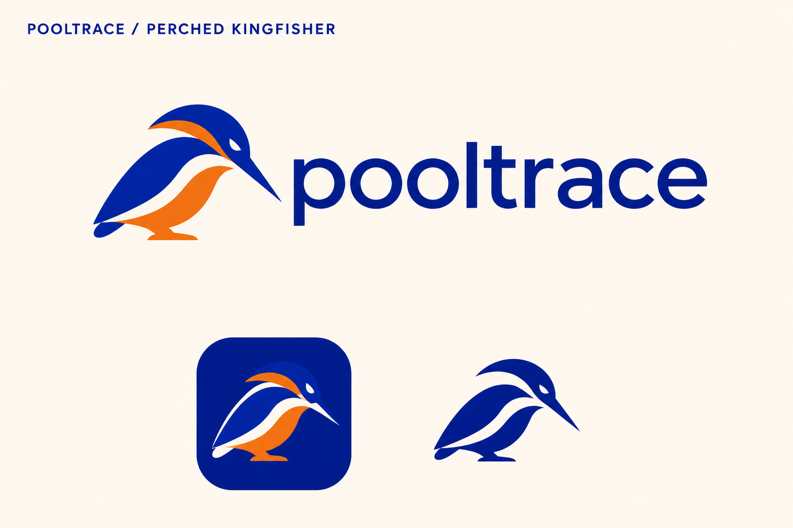

# Brand reference

Pooltrace's selected mascot is the **perched kingfisher**, using the preview supplied by the user.
Preserve its sitting pose and recognizable silhouette.

The PNG is an unchanged reference preview, not a finished vector master or production asset set.
No generation, tracing, recoloring, or design revision is authorized by this setup task.

Production work is tracked as **BR-01** in [the backlog](../BACKLOG.md). It includes reviewing
vector, wordmark, mascot-only, monochrome, light/dark, favicon, and small-size variants. The terminal
palette may be refined; green/red should retain profit/loss meaning. Do not substitute a diving
bird, owl, or generic crypto icon.

Keep source/provenance and the approved palette with the eventual production assets. Financial
presentation rules are defined in [CORRECTNESS.md](../CORRECTNESS.md), requirement CR-11.
